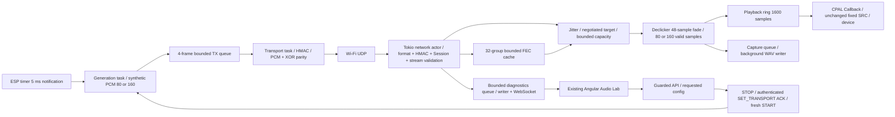

# MyMic Audio Lab v1

Audio Lab 整合於既有 Angular 控制台，使用既有 localhost API token／Origin guard、Session HMAC 與 WebSocket。提供 10／5 ms PCM、4+1 XOR FEC、20／30／40／50／60／80／100 ms Jitter Target。這次沒有加入自適應 SRC 或 Stage B–D 的漂移／恢復策略。

## Audit 與資料流

原先 `mic-protocol` 與 C `packet.h` 僅接受固定 368-byte v1 音訊、160 samples；ESP32 `generation_task` 用 FreeRTOS 10 ms tick，4-frame queue 與 transport task 分離。TX 是合成音源，沒有 I²S。Rust `mic-network` 單一 Tokio actor 負責 UDP、控制 ACK、10 ms playout tick；Jitter 目標 clamp 2–4 包、容量 8 包、signed wrapping sequence window。Declicker／Capture／Playback feed 固定 160 samples。CPAL Callback 從 1600-sample ring 經固定 ratio 的線性 SRC 取音；可在 starvation 後預填充，ring backlog >960 samples 會 clear。Diagnostics 由 bounded queue 交給背景 writer，WebSocket 不承擔播放。

實作依賴順序：v2 packet/config schema → C TX 與 Simulator → frame-aware Jitter/Declick/Capture → FEC receive → ACK negotiation → API/WS/UI → regression。原 v1 encoder／decoder與 golden vector 保留。5 ms 的內部儲存使用固定 `[i16;160]`，只有前 80 samples 有效，所有 feed/capture/sample accounting 都使用實際 count；沒有把兩包湊成 10 ms 才播放。

## 操作

1. 編譯並啟動 RX，在原控制台配對 TX。新版 Discovery 能力含 `audio_lab_v1`；舊裝置仍使用原 Baseline，Lab 控制拒絕不支援的裝置。
2. 選取 Audio Lab 裝置，設定 frame／FEC／target，按「停止／套用／恢復串流」。原先播放中會恢復播放；原先停止則保持停止，可用原裝置面板 START。
3. 等待 Applied；Requested 是待確認，Failed 不是成功降級。切換是有意的停止／清空／新 epoch／預填充，可能有短暫斷音，不是無縫調參。
4. 先完成切換並穩定播放，再建立 Baseline／Experiment 區間。結束後同頁選 A/B 比較並匯出 JSON。設定快照、Session、diagnostic stream／clock、版本、monotonic counter window、差值與 JSONL artifact 路徑都保留。
5. Browser localStorage 最多 20 場、每場 15 分鐘／1800 次快照；離線、串流變更及 counter reset 會標示 invalid。正在錄製的區間不自動續接到新 Session。儲存 quota 失敗會顯示錯誤，需立即匯出；關閉瀏覽器不影響音訊，但會失去未結束的 Lab 區間。

UI 的 interval P50/P95/P99 母體是 **500 ms WebSocket 快照採樣**，不是所有 packet／callback。完整逐包／逐回呼母體使用既有 Diagnostics JSONL 與 summary。Counter window 使用 RX snapshot acquisition monotonic timestamp，並保留開始／結束 UTC 作為場次標籤；原累積 counter 不直接當成場次結果。CPAL/Pipeline inserted silence 與 FEC、sequence gap、late/drop、resync/recovery 分開保存。未蒐集 TX 版本或間隔顯示 unavailable，不推估。

Core與Diagnostics快照會分別取得；場次保留core的`startMono/endMono`及Diagnostics的`diagnosticStartMono/diagnosticEndMono`，不假設兩者完全同時。Core snapshot的`diagnostic_stream_id`必須和Diagnostics current stream一致才可開始，避免剛套用新設定時把舊counter/config快照綁到新stream。Diagnostics關閉／切換或drop改變，事件母體標incomplete。另保存wireVersion與physicalCapacityPackets，舊v1／Lab v2基準的實體容量差異不能隱去。

RX socket datagrams/bytes、authenticated PCM arrivals/bytes、Jitter push（含repair）是不同母體；場次分開保存并計算實際UDP payload kbps，socket母體包含parity/invalid、不含IP/UDP/Wi-Fi額外開銷。FEC的TTL決策按事件發生時間進入區間，區間結束仍未到TTL的分組不能算成已確認失敗。

Estimated queued audio = contiguous Jitter duration + ring samples/16，僅描述已排隊的內部音訊，排除 resampler history／WASAPI／device buffers。Packetization 與 Target 是設定值，**不是實測端到端延遲**；後者固定顯示「尚未量測」，需 loopback 或可信同步量測。

## Jitter 行為與已知風險

未協商 v1 Baseline：原設定（CLI 2–4 包）、容量 8 包。協商 Lab：target packets = target_ms/frame_ms，實體容量 = 160 ms/frame_ms（10 ms 16 包、5 ms 32 包），獨立於 target。Occupancy 是儲存包數；actual buffered duration 是 occupancy×frame duration；contiguous playable depth 從 expected_seq 起遇缺口停止。初始化仍採原 occupancy prefill 策略，不保證全連續；缺口會按期限補零，沒有等 FEC 的額外阻塞。所有值有明確單位。

容量 admission、late／forward window、缺包補零與 empty rebuffer 策略延續原實作；沒有把 A.5 的滿載缺口循環偷偷修掉。即使容量有界、cursor 前進，仍可能持續出錯，詳見 [A.5](drift-stage-a5.md)。FEC 不會直接解決播放時鐘漂移，也不保證解決這個循環。未來 Stage C 仍須獨立批准與驗證。

## 驗證與硬體邊界

新增測試：C/Rust/Python v2 shared vectors；5/10 ms strict payload/HMAC/config signing；四個位置的單包遺失、兩包／parity 遺失、亂序／重複、Session/stream 隔離、wrap、TTL／capacity、deadline watermark；實際 Jitter 的所有 target/sample accounting；實際 Engine＋Renderer 的 A–E 60 秒虛擬矩陣、440 Hz／FSDD 語音、單包及連續遺失、2/5/10/20 ms delay、50 ms callback stall、Diagnostics On/Off checksum；真實 localhost UDP Simulator／API 設定；ACK mismatch／retry／reject／timeout與失敗後的安全 restart；前端區間差值與 reset。

四個既有 ignored 長測試維持原狀，其中 A.5 零漂移自癒 contract 是已知未满足條件，不列為通過。本任務不宣稱已完成 ESP32 燒錄、Wi-Fi matrix、30 分鐘 Lab soak、實際 I²S、聲學連續性或 loopback 延遲量測。

操作矩陣與測試指令見 [Benchmark](audio-lab-benchmark.md)，協商見 [Transport](transport-configuration.md)，FEC 的精確計數語意见 [FEC](fec-design.md)。
