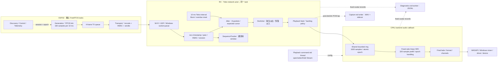
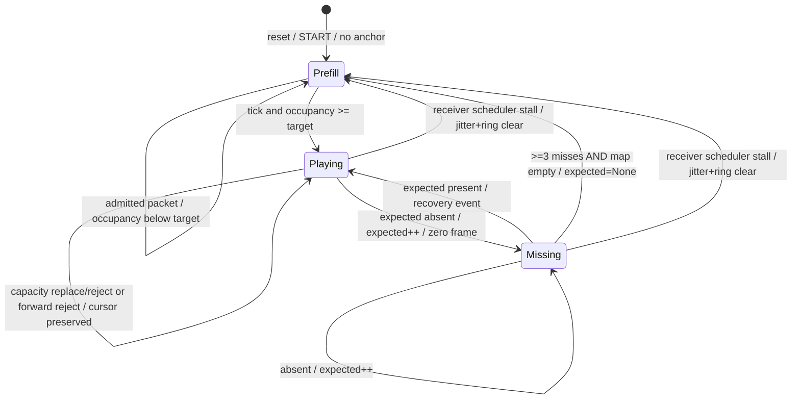

# MyMic RX Clock Drift Compensation 與 Resync 架構審查

審查日期：2026-10-11（Asia/Taipei）。原始碼基準：`4349c1b`。本次只讀取程式碼、官方資料與既有本機 JSONL，新增本文件；沒有修改 RX 核心、UDP、jitter 參數或執行實機測試。

後續授權：Stage A 已批准並實作，結果見 [drift-stage-a.md](drift-stage-a.md)；Stage B–D 暫緩。本文件仍保留 `4349c1b` 的審查事實與分階段提案，不代表所有提案已實作。

## 1. 結論與優先順序

1. **沒有現成等效 ASRC／drift controller。** `Resampler::new` 固定 `step=16000/device_config_rate`；phase 跨 callback 延續是正常 SRC，並不估測或補償 clock drift。de-click、output fade、capacity reconciliation、backlog clear、rebuffer 都不是 drift compensation。
2. **目前有兩個串聯的速率邊界。** TX→jitter 與 jitter→device 分別由 TX production、RX 10 ms timer、Windows device callback 控制。只調 callback SRC ratio 不會改變固定 timer 的 jitter dequeue rate，不能消除 TX→RX tick 的長期失配。
3. **先做 Stage A。** 補 source timestamp、實際 feed/drop 與 timer deadline 觀測，提供 bounded 的長期摘要／故障前後 trace。現有逐筆 log 有 64 MiB 程序上限，本機檔案已達此限，不能直接拿它驗收 30 分鐘。
4. Stage B 可先做 **ring-only ASRC 可回退實驗**，但驗收名稱必須限定為 RX tick→device。完整補償還需要讓 jitter dequeue 跟受控的 media demand 或自適應 media deadline 耦合；不能只用「兩個 buffer 合計 occupancy」控制下游 ratio，而保持上游固定出列。
5. Stage C 先建立 resync 測試／明確 playout epoch。已確認空 deadline 重建 anchor 可回到先前已補零的 sequence slots，屬時間軸 rebase，不能當成平滑正常播放；尚無證據證明它導致本次永久斷音。不要先將預設 capacity policy 改回整批清空。
6. Stage D 的 adaptive jitter／真正 PLC 需前面證據支持。增加 latency 或 PLC 能掩蓋症狀，不能修正平均速率差、actor stall 或 device fault。

## 2. 實際程式碼與 Task 邊界

以下位置相對本文件，行號參考 `4349c1b`，symbol 為主要定位依據。

| 路徑／位置 | 已確認行為 |
|---|---|
| [TX generation_task](../firmware/esp32-tx/main/main.c#L343)、[audio_source_frame](../firmware/esp32-tx/main/audio_source.c) | `vTaskDelayUntil(10 ms)`，每幀160 samples；sequence 在 generation 遞增，timestamp 為 source sample index。現在是合成音，沒有 I²S capture clock。START epoch 重置 sequence/sample/phase。 |
| [TX transport_task](../firmware/esp32-tx/main/main.c#L384) | 四幀 queue；generation queue 滿移除最舊，transport 獨立 drain、編碼/HMAC/sendto；send success 非遠端 delivery。 |
| [UDP actor run](../crates/mic-network/src/lib.rs#L198) | 同一 Tokio actor 的 select 處理 discovery/control/audio、commands、maintenance 和 playout timer；task 可在 runtime worker 間遷移，不是假定固定 OS thread。peer/HMAC/session/Streaming 驗證後才進 Engine。 |
| [Engine receive_at](../crates/mic-audio/src/lib.rs#L905) | RX arrival 在 socket recv 完成／decode 前取 Diagnostics RX us；不是 NIC/kernel timestamp。packet timestamp 用於 inter-arrival jitter calculation，沒有用來安排 playout。 |
| [SequenceTracker](../crates/mic-audio/src/sequence.rs) | 與 jitter cursor 獨立；40 ms reordered-gap grace、256 recent 序號，累計 finalized gaps/reorder/duplicate；尾端無後續較高序號不知總 loss。reset 保留累計 counters。 |
| [Jitter push_inner/tick_inner](../crates/mic-audio/src/lib.rs#L331) | 八包、target clamp 2–4；prefill 看 map occupancy，不看 contiguous。operational tick 每次都 expected+1，包括缺包；缺包160 samples零。 |
| [actor timer branch](../crates/mic-network/src/lib.rs#L274) | nominal 10 ms、MissedTickBehavior::Burst；deadline >20 ms overdue 時 timer reset、Engine rebuffer，否則可 catch-up 多次 tick。branch 中 overdue 檢查在 active streaming gate 前。 |
| [Engine tick/reset/rebuffer](../crates/mic-audio/src/lib.rs#L953) | tick→jitter→de-click→feed；started 或 was_started 才 feed。一般 reset 清 tracker history、jitter、ring、declick；scheduler rebuffer 清 jitter/ring/declick，**不重置 SequenceTracker**。 |
| [Playback feed/clear](../crates/mic-audio/src/lib.rs#L685) | ring 1600 mono samples=100 ms capacity；feed 前 len>960=60 ms 清 ring 並記 backlog clear，仍插入本幀；opened=false 不 feed。clear 增 epoch，callback 可辨識舊樣本。 |
| [CPAL build](../crates/mic-audio/src/lib.rs#L760)、[Renderer](../crates/mic-audio/src/output.rs#L159) | 專屬 playback command thread 持有 Stream；CPAL backend callback 執行 render，非 Tokio actor。以實際 buffer requested frames、device rate 消耗 ring，輸入 mono16k，插值、fade、format conversion/channel replication。 |
| [Resampler](../crates/mic-audio/src/lib.rs#L91) | `step=16000/F_config`，兩樣本 lookahead、fractional phase、while phase>=1 取輸入，沒有動態 ratio setter。 |
| [Diagnostics](../crates/mic-audio/src/diagnostics.rs#L138)、[Capture](../crates/mic-audio/src/capture.rs) | 各自 std thread 寫入；event queue2048、observation queue4096，capture queue128×160 samples，30秒 cap。RT callback 不 serialize／I/O；error callback 另維護 output state。 |



Shared ring 是 actor producer、callback consumer；命令 thread 可 clear，因此 epoch/raced pop 防護不能在 ASRC 整合時移除。圖中的 WASAPI/device 是 downstream 邊界，不表示已量到硬體播放時間。

## 3. 既有本機證據及證據等級

等級：**E1**＝原始碼可確認；**E2**＝既有檔案的直接觀測，來源／binary／測試 scenario 尚未完整核對；**E3**＝由 E1/E2 推導的可測假說；**E0**＝尚無對應量測。E2 不是本次新執行的 ESP32 acceptance。

唯讀掃描 `Diagnostics/events-1791648113726-18772.jsonl` 與相鄰 `capture-1791648482932-18772-1.json`：

* log=67,109,010 bytes，已超過64 MiB門檻一筆行大小，與 writer「達限停止寫入」設計吻合（E1+E2）；最後 RX time=411,957,448 us。不能把這之後缺事件解讀為健康。
* stream_start=324,557,078 us；packet0 arrival=324,569,153，最後packet8739 arrival=411,954,305。**active packet 視窗只有87.385秒**，前面約324秒為 idle／startup。stream0有35,561 records，stream1有53,346。非30分鐘 drift trace。
* 有27 callback starvation、27 callback recovery、11 jitter underrun、8 late、7 jitter recovery、1 three_empty_deadlines、1 callback delay；此檔 **沒有 jitter_capacity_reject_farther**。最後 health enabled=true、drops0、error=null，僅證明停止記錄前的狀態；cap 後 error 只能從仍運行的 API／後續 metadata 取得。
* packet端點 finalized gaps 均0，不代表沒有deadline缺包，也不是RF零loss認證。expected844缺包 at333,027,873，packet844 late at333,031,657：有明確 missed deadline→後到證據，不能區分 TX／transport／socket／actor 延遲。
* callback entry gap33,809 us，previous budget10,000 us，ring798、jitter5：callback cadence gap 與輸入積壓可同時存在，不能把此事件推成 network starvation。
* 10秒完整 bins 的 post-dequeue jitter mean：330–340秒1.666包、340–350秒2.534、350–360秒4.713，之後約4.719–4.801；ring entry mean 約463→479→595 samples。這是窗口平均的**階梯／平台**，不是已確認的持續線性 drift；包含 resync、burst、callback delay，不能直接 fitting 全段得到 crystal ppm。
* capture為480,000 samples、drops0、RX369,310,358–399,310,988 us，sidecar error=null。仍是 pre-ring/pre-resampler tap；不證明 Windows 30秒实际播放連續。

| 根因候選 | 證據／限制 | 下一個判別量測 |
|---|---|---|
| TX production vs RX timer 長期失配 | E1：獨立 cadence／固定 dequeue；E3：可累積 jitter occupancy。沒有 E2 的30分鐘穩態斜率支持本次故障。 | unwrap source timestamp vs RX time、actual tick count/deadline、jitter playable-depth trend，排除 rebase/loss 段 |
| RX feeder vs device 消耗失配 | E1：fixed SRC；E2：ring與callback deficit；E3：可能 drift，也可能排程／prefill。 | requested device frames、valid16k input consumed、ratio／phase、ring accepted/drop/clear，分 output epoch |
| arrival delay／batching／真正丟包 | E2：有缺deadline後late；沒長期capacity trace；RX无法證明哪一跳丟失。 | RX header timestamp、TX queue/send logs、packet capture與資料完整性 |
| actor catch-up／schedule reset造成積壓或重定錨 | E1：Burst與>20ms reset；E2：有empty reset但沒有本檔receiver_scheduler_stall。 | planned deadline vs actual execution、每次catch-up數量、rebase前後cursor/source span |
| sequence recovery跨窗口不一致 | E1+E2：empty reset可以rewind已補零slots；E3：可改變 delay，但未證實永久停滯。 | playout_epoch、old/new expected、anchor reason、raw sequence window與playout window分開 |
| Windows mixer/driver/device | E0：callback data非硬體position；restart RX改善不是排他證據。 | 同時 loopback、output error／device epoch；需要時 Windows ETW/DPC/device position |

RX restart 同時清 buffer/cursor/phase/controller狀態並重建 output/session，會改變多個條件；「不需重啟TX」只提高 RX/stateful 路徑的調查優先級，不能單獨確診 WASAPI 或 drift。

## 4. 時鐘與可估測的 rates

### 4.1 時鐘清單

* **TX generation cadence**：RTOS tick，sdkconfig `CONFIG_FREERTOS_HZ=1000`；nominal10ticks每160 samples。不是16000Hz的獨立ADC/I²S oscillator；實際 production rate受ESP時基與task執行／catch-up影響。source.sample是計數器，非wall clock。
* **TX measurement**：`esp_timer_get_time()`；與RTOS tick都是ESP側時基，程式碼不能證明它們為兩個獨立物理 oscillator，更不能相減TX與RX原點。serial有local windows及stage times。
* **RX monotonic**：Diagnostics `Instant` origin；Tokio deadlines也用主機monotonic API，來源可相關，不視為另一個晶振。actor的實際執行仍受Windows排程影響。
* **Device/Windows audio cadence**：CPAL requested frames／callback與backend output clock；F_config為nominal格式，不是physical DAC rate量測。shared-mode Windows可能有自己的mixing/SRC。callback entry對RX clock的斜率是有效交付節奏，不等於硬體oscillator drift。
* UTC只供人讀；所有估測、控制和test virtual times用monotonic。output reopen、session START、jitter reanchor都需切估測窗口。

### 4.2 定義與公式

令 t為RX秒，s為同source epoch unwrap後的header sample index，D為累計device requested frames，I為valid16k input實際消耗，N為unique authenticated arrivals，G為實際jitter slots出列（含補零）。各斜率用同窗口實際 elapsed，不用假定每tick恰10ms：

```text
f_source_apparent = slope(s vs t)                    [source samples/RX second]
r_arrival        = ΔN / Δt                          [unique packets/RX second]
f_device_effective = ΔD / Δt                        [device frames/RX second]
f_input_consumed = ΔI / Δt                          [16k input samples/RX second]
f_jitter_slots   = 160 * ΔG / Δt                    [logical input samples/RX second]
ppm_source_host = 1e6 * (f_source_apparent/16000 - 1)
ppm_device_host = 1e6 * (f_device_effective/F_config - 1)
ppm_source_device = 1e6 * ((f_source_apparent/16000)
                         /(f_device_effective/F_config) - 1)
```

`f_source_apparent`近似 generation timeline rate，而非收到完整音訊的rate；source index跨遺失包仍前進。ΔN少可因loss／duplicate去除；不要拿160×ΔN當TX production。ΔI在starvation、epoch discard、prefill時低，不可當純 device clock。Stage A必須額外記 source timestamp，目前udp_receive只有sequence；不能永久假設sample_index=160×sequence來省略驗證。

arrival模型 `t_arrival=a+b*s+d(s)`，b與clock mismatch有關，d包含TX queue、network及RX dispatch。delay的長期線性變化與clock slope在RX端**不可識別**。建議以1–2秒分桶的lower-envelope／低quantile arrival residual，60–120秒 robust slope，對比10/30/60秒 rate及occupancy slopes；提供count、窗口、残差、confidence和invalid reason。low-quantile不是排除所有網路因素的證明：路由／queue慢變或RX排程偏置仍可冒充ppm。

只在同epoch、單調unwrap、無rebase、資料完整且無持續loss/starvation的窗口輸出「apparent ppm」。捕捉loss/reorder/spike，但不要靜默删掉錯誤或把invalid改成0。估計50ppm需夠長窗口：120秒只累積6ms相對偏差，仍可被幾ms delay變化覆蓋。應提供窗口敏感性／confidence；不足就unknown。

### 4.3 兩段buffer的守恆關係

在無loss/reset、音訊持續且餘數lookahead忽略的線性化區域：

```text
J_dot = f_TX - f_tick                             (jitter中的source samples)
R_dot = f_tick - r * f_device                     (ring中的source samples)
r_nom = 16000 / F_config
r     = r_nom * (1 + u), |u| <= 0.001
```

因此 ∂J_dot/∂u=0。下游ASRC能穩ring，不會自行穩jitter。兩段合計看似不變也可能J上升、R下降，不能合計掩蓋個別邊界。loss/PLC、capacity eviction、ring discard、source rebase都另列守恆項，不能用occupancy reset後零斜率宣稱drift已解決。

漂移量級（分析算式，**非實測**）：16k×ppm×10^-6→每秒多/少samples。

| 漂移絕對值 | samples/s | 累積一包160 samples | 30分鐘無控制累積 |
|---|---:|---:|---:|
| 50 ppm | 0.8 | 200秒 | 1440 samples / 90ms |
| 100 ppm | 1.6 | 100秒 | 2880 / 180ms |
| 500 ppm | 8 | 20秒 | 14400 / 900ms |
| 1000 ppm | 16 | 10秒 | 28800 / 1800ms |

幾分鐘後碰capacity與小drift量級相容，但也與delay rebase／積壓相容，仍是E3。

## 5. Adaptive SRC：兩種控制策略與整合

### 5.1 共用約束及正負號

保留現有linear SRC作第一個實驗；不要為±0.1%先引入完整NetEQ或新的高品質filter庫。正u使每個device frame消耗更多input：buffer偏高→u正；偏低→u負。相位、a/b和fade flags跨ratio更新連續，**不得為更新ratio而reset**。

選可控制的buffer：ring-only實驗q=R/16000；完成demand bridge後，健康無hole窗口可q=(R+160×contiguous_jitter_depth+resampler_pending)/16000。future但不contiguous資料不能當已可用時長；短期hole、recovery、mute/source silence不靠sample振幅判斷。q_target先由Stage A建立與原latency配置一致的budget，不任意加大prefill或capacity；B的確切target是驗證前必須決定的設計參數，非現有已實作數值。

控制worker/actor每100ms計算一次，按實際Δt用 `alpha=1-exp(-Δt/τ)`（τ初試2–5秒）。callback只讀atomic fixed-point target ppm及epoch，在本地每device sample平滑step，或按buffer長度線性ramp；slew初試10–50ppm/s、hard limit±1000ppm，非生產保證。不要把callback大小變化當ratio跳變；44.1/48/16k均測，固定bounded work／無lock／無I/O。

簡化 plant：q_dot≈d-u，q/e單位秒，d/u為fractional rate。ring-only 的 feed-forward 必須是 `u_ff=f_tick/(r_nom*f_device)-1`；完成media-demand橋接後才用 `u_ff=f_source_apparent/(r_nom*f_device)-1`。不能把source ppm直接套到未改出列速率的ring環。健康filtered error e=q_filtered-q_target：

| 比較 | Low-gain PI | EWMA + P |
|---|---|---|
| 演算法 | `u_raw=u_ff+Kp*e+z; z+=Ki*e*Δt` | `u_raw=u_ff+Kp*e` |
| 暫定simulation起點 | Kp=0.04 s^-1、Ki=0.0004 s^-2（ppm計算前乘10^6） | Kp=0.04 s^-1，同EWMA和slew |
| steady state | 無飽和/擾動，integral可消常數rate error | u_ff=0時需e=d/Kp；1000ppm需25ms偏移，可能超低延遲buffer headroom |
| response/stability | 不含filter時char eq λ²+Kpλ+Ki，起點critical damping；filter/quantization/delay改變穩定性，必須sweep | q本身integrating plant，無filter時time constant約1/Kp=25秒；簡單可解釋，加入filter仍需測 |
| saturation | clamp±1000ppm，slew也是限制；saturation time明示 | clamp/slew，沒有integrator windup，但邊界外無法控制 |
| windup | conditional integration（已飽和且error欲加重時停止）或back-calculation到**實際slewed u**；epoch切換clear、invalid窗口freeze | 不累積integral，但filter可記住burst，rebase時重建filter |
| jitter追逐 | 慢filter、low gains、loss/reset freeze；integral更容易把長burst學成drift | filter後P短暫改ratio，再回復；長delay變化仍可能誤認drift |
| 成本/建議 | 少量scalar state，之後可達零steady offset；只有simulation證明才選PI | 最容易做可回退初試；配可信apparent-rate feed-forward u_ff可降低offset，但估測偏誤仍要feedback限制 |

上述gain是待驗證proposal，不是來源系統的參數也不是已調好數值。在±1000ppm剛好limit時沒有額外回復headroom；不能要求不論初始queue位置均回target。验收需允許bounded offset、或在startup校準目標／有明確一次性的rebase。±1500ppm越界試驗應顯示飽和／不可維持健康，不宣稱±1000ppm控制器能處理它。

### 5.2 對現有雙buffer的選項

**B0：保持10ms actor timer，僅ring ASRC。** 最小程式改動：ratio target/callback smoothing和ring telemetry。適合驗證host-feeder/device失配，必须同時展示J與R；若J仍單向漂移，報partial compensation。用J+R feedback並不會讓u作用到J，甚至會把R拉空。

**B1：bounded media-demand feeder + ASRC（完整方向，需獨立設計測試）。** 保留network actor、Jitter資料結構、wire/session；讓ring低水位／callback累計input demand決定actor側何時補下一個160-sample logical slot，而不是無條件每host10ms tick。callback只更新atomic需求／已消耗量，不做Jitter操作或等待actor。actor可用現有receive喚醒配合feature-gated短poll wake（例如1–2ms，需量CPU／Windows排程），每wake最多固定幀數並限ring headroom。預算來自device media需求與r；producer不能因UDP burst就整批灌滿ring。

關鍵：把「提前搬移已到的expected PCM」與「缺包到了playout deadline才產生PLC slot」分開；不能為填ring在同一wake跑三次缺包tick，瞬間觸發empty resync。啟動維持既有target/320-sample prefill，不新增fixed latency；在同epoch以cumulative media credits + fractional remainder產生source slots，credits須包含nominal output進度及ratio，不只用成功input consumed（starvation時其為零）。輸出inactive/停止時不累積無限credits；recovery重新baseline、drop backlog credits有reason。actor stall後 bounded rebuffer，不能无限catch-up。

B1未必是一個小patch；需先用virtual multi-clock harness驗證這個橋接。它是端到端ASRC必要條件之一，而非本次核准的程式變更。替代方案是actor自適應media deadline跟隨source/occupancy + ring ASRC雙控制環；需要fractional deadlines、phase continuity和兩環協調，比B0成本更高，不建議在尚無Stage A數據時一次引入。

## 6. Jitter／Resync 狀態機及不變条件

### 6.1 現行行為（由多個bool實現，非既有enum）



Playback另有Inactive→Prefill320→Rendering→StarvedBatch→Prefill320，epoch變更使resampler reset及fade；ring backlog clear會重建playback epoch，**不重建jitter cursor**。empty jitter reset不清ring；scheduler rebuffer清ring；不能將兩個狀態機視為同一reset。

### 6.2 不變條件／審查結果

| 不變條件 | 現行結果／缺口 |
|---|---|
| operational tick不因缺expected永久停住 | **成立（E1）**：每tick先expected+1；3次miss且空map re-prefill。沒有實證永久cursor freeze。 |
| occupancy≤8、有明確overflow | **成立（預設E1）**：保留近cursor資料，replace farthest或reject farther，各drop1；legacy off才整批clear。`BUFFER_RESYNC`名稱不表示實際reanchor。 |
| stale資料不能卡住後續 | 運作中behind packet拒絕；已存future在cursor前進後被取走。在正常預設window且tick持續時有progress；要property test佐證，不能推廣到actor永久不排程或無valid arrivals。 |
| cursor/window一致 | 正常可保持；empty reset只expected=None、不清seen；scheduler reset清jitter seen但不重置觀測用SequenceTracker。需要明確區分raw network epoch、jitter playout epoch、ring epoch。 |
| wrap正确 | `ahead=(wrapping_sub as i32)>0`；half-range模糊，default forward distance>100拒絕；现有wrap單測，不代表sample timestamp長期unwrap已存在。 |
| prefill能保證可播 | **不成立為強保證**：只len>=target，map={0,10,11}會開始，play0後miss1…；容量滿與expected hole可同時出現，不能叫矛盾。 |
| 斷線有界恢復 | 條件式：tick≤設定late bound、valid packets恢復／prefill可達、session已ACK時可恢復。無network/OS上限不能保證絕對wall-time。>100前跳空後重定錨；future-map非空時等cursor走到最近資料。 |
| resync後media timeline單調 | **需定義epoch，不能當連續保證**：empty reset會重新anchor到已補零的slots。這是確認的rebase行為，不是證明根因。 |

具體E2：expected2252、2253、2254在RX347,108,770／347,118,119／347,129,136 us三次dequeue `delivered=false`，第三次started=false；Engine的was_started使這三幀仍可feed。RX347,137,791下一次dequeue expected2252且delivered=true、occupancy5。先輸出三個缺包slots，再回到2252播real PCM，增加一段source timeline lag；raw seq gap0可與此並存。Stage C應先把這案例變成actual-code regression，量測延遲與cursor transitions，再決定是允許explicit rebase、丟棄過期slots或跨fade新anchor，不能不記錄地改行為。

### 6.3 建議Stage C狀態／API contract

增加local `playout_epoch`（不改wire/session），所有真正anchor change統一記 old/new cursor、source timestamp、reason、discard counts；capacity reconciliation不遞增它。明確 `Prefill / Playing / Concealing / Rebuffering / Stopped` transitions。維持獨立raw UDP tracker以保留loss證據；不要为了與jitter一致把網路gap history洗掉。

reanchor transaction由actor持有Jitter狀態：決定eligible新anchor／purge window／bounded seen policy／controller reset；需要discard downstream時使用現有ring epoch使callback丟棄stale inputs。是否保留ring/fade是reason-specific策略，不能每capacity事件clear。補零／PLC推進logicalcursor一次、超時前跳必須有bounded recovery path。先證明壞案例，再最小修改；現階段不主張更改overflow policy、prefill或mute semantics。

## 7. 成熟系統對照（官方文件／原始碼）

來源於2026-10-11查閱；WebRTC下列原始碼為**具名歷史commit示例**，不是宣稱目前main版本完全相同；GStreamer main是moving reference，實作時需再pin revision。沒有複製整套程式或其參數。

| 系統 | 實際設計及來源 | 可借用原則 | 不適合直接搬入MyMic |
|---|---|---|---|
| WebRTC NetEQ | [官方概要](https://chromium.googlesource.com/external/webrtc/+/refs/heads/main/modules/audio_coding/neteq/g3doc/index.md)：InsertPacket / 每10ms GetAudio、adaptive delay、time-scale、PLC/merge。 | media-demand playout、arrival與playout同模型、缺包與time-scale區分 | codec framework、DTX/CNG、DTMF、FEC/RED/NACK、AV sync；目前無對應wire/codec需求 |
| NetEQ buffer/controller | [BufferLevelFilter::Update](https://webrtc.googlesource.com/src/+/bc2959072dc590527d989e83ae9c899c82f45fd4/modules/audio_coding/neteq/buffer_level_filter.cc)濾buffer並account time-scaled samples；[DecisionLogic::ExpectedPacketAvailable / FuturePacketAvailable](https://webrtc.googlesource.com/src/+/7f6417f480e79511ab186354bf7cd8b43765f415/modules/audio_coding/neteq/decision_logic.cc)依buffer與timestamp選accelerate/preemptive expand/merge/reset。 | 控制用filtered media depth、控制動作與reset要納入量測；phase/sequence狀態不能各自失配 | 其time stretching不是MyMic linear ASRC；不能當作可直接照抄的PI設計 |
| NetEQ delay target | [DelayManager::Update](https://webrtc.googlesource.com/src/+/46814941f21320708ce2abe8d451658bcec06a0c/modules/audio_coding/neteq/delay_manager.cc)綜合relative-arrival及reorder optimizer並限制delay。 | network jitter target與慢速drift調節分離、target有上下界 | 此次先固定MyMic jitter配置；不直接套其delay／buffer大小 |
| GStreamer rtpjitterbuffer | [官方element文件](https://gstreamer.freedesktop.org/documentation/rtpmanager/rtpjitterbuffer.html)：RTP排序/去重、latency等待、late/lost事件、drop policy、timestamp/slave mode。 | 明確deadline/lost/late區分、bounded等待與可觀測policy | RTP/RTCP、RFC7273、RTX與MyMic packet不同；此element不是直接PCM ASRC或device oscillator補償 |
| GStreamer skew/window | [rtpjitterbuffer.c calculate_skew / rtp_jitter_buffer_calculate_pts](https://github.com/GStreamer/gstreamer/blob/main/subprojects/gst-plugins-good/gst/rtpmanager/rtpjitterbuffer.c)：比較sender與arrival時間、bounded window低delay樣本／smooth、gap/restart處理。 | robust lower-envelope、基準重建、timestamp unwrap與異常gate | 校正PTS不會直接改MyMic SRC samples；不能只改timestamp就期待ring rate平衡 |
| MyMic | 來源為第2節：sample-index header／fixedhosttick／fixedSRC、bounded queues、fade-to-zero、reason events。 | 既有小型queue、RT安全及診斷可延用 | 缺慢速估測／可調ratio、完整clock-domain bridge、playout epoch／長期摘要；fade不是內容重建PLC |

PLC先採低成本受限waveform continuation／短期repetition+衰減候選，而非把前幀無限重播。長loss降至silence，recovery利用現有fade／merge邊界。需用speech與tone驗證自然derivative，不能只以seam delta0判斷無artifact。Codec PLC不適用原始PCM而無decoder狀態的此路徑。

## 8. Stage A–D 可獨立驗證實作計畫

所有feature flags以下為**提案，尚未實作**；off必須保留現在的PCM／cursor semantics。各stage獨立commit、schema與binary hash/provenance一併驗證。

| Stage | 修改檔案（規劃）／核心演算法 | 風險／回退 | 測試及驗收 | 延遲影響 |
|---|---|---|---|---|
| A Drift Telemetry | `mic-audio/{diagnostics,lib,output}.rs`、`mic-network/lib.rs`、`scripts/analyze-continuity.py`、相關tests/docs；重用clock/queues，加source timestamp、tick scheduled/actual/overdue、feed accepted/drop/clear、callback valid consumption／phase／output epoch、reanchor epoch；1秒bounded摘要+10/30/60/120秒slopes/confidence；JSONL rotation／故障tracebudget | I/O與高頻觀測影響排程；`MIC_DRIFT_TELEMETRY=off`；既有disabled/drop/error仍可用；不增新的無界history。rotation有manifest与gap/drop資訊，disk總預算有界，30分钟保留1Hz摘要不可被idle逐callback淹沒 | 同seed/off/on PCM bit-exact與events一致；rate母體、wrap、loss/reorder/gaps/epochs、forcedcap/diskfail；至少30min完整摘要、有缺口明報unknown | 不改音訊目標延遲；需CPU/IO A/B確認observational overhead |
| B Clock Compensation | `mic-audio/{lib,output}.rs`，新`drift.rs`小型controller；B1另`mic-network/lib.rs` media-demand bridge；reusephase, atomic target, EWMA+P先shadow再output，之後PI comparison；ratio±1000ppm/slew/antiwindup | `MIC_DRIFT_COMPENSATION=off|ring|end_to_end`；`MIC_DRIFT_CONTROLLER=p|pi`；預設off。B1 credits/holes/actor scheduling風險，必須與B0分開驗收 | ±50/100/500/1000ppm雙clock独立矩陣；0ppm透明；ratio無step/reset、buffer bounded；ring mode不得冒充jitter修復；end-to-end須兩buffer都無單向漂移。越界明示saturation | nominal SRC不加lookahead；bounded occupancy offset改變動態latency，必須報target/observed。B1不任意增加prefill，wake成本需量測 |
| C Resync Hardening | `mic-audio/{lib,sequence,diagnostics,output}.rs`及必要actor hook／tests；actual-code regressions先行，再localplayout epoch、reason-specific reanchor/seen/epoch transaction；不洗raw network累計證據 | `MIC_TEST_RESYNC_HARDENING=off|on`，defaultoff直到通過；reanchor會丟／重播內容、latency step、reset太積極；rollback回既有policy | stale/nonemptyfuture/full-hole、small/backward/largejump、half-range、wrap、2252 replay、missing/late/duplicate及sessionstart；在所定輸入/排程上界下≤500ms恢復，不能promise無條件OSdeadline；无silentepoch rewind | 恢復時可一次性latency rebase及fade；正常path不增delay，丟棄量明示 |
| D Adaptive Jitter / PLC | 證據足夠才動`mic-audio/lib.rs`, `declick.rs`或新`plc.rs`、tests/docs；bounded target adaptation或最多1–2幀PCM concealment，longloss衰減至silence | `MIC_ADAPTIVE_JITTER=off`、`MIC_PLC=zero|experimental`；PLC artifact／CPU／speech失真、adaptive delay震盪。default維持既有配置，參數變更另明確授權與驗收 | Stage B/C合格後，對延遲超現有budget仍頻繁late的scenario提出必要性；PLC sourcequality/longloss/recovery、no invented packet delivery/loss counters | Adaptive jitter可能增加端到端delay，先訂budget；受限causal PLC不需新lookahead，若有future-sample需求必須列實際增加延遲 |

Stage A先新增或明確分割三個epoch：wire Session/START stream、jitter playout anchor、output/ring generation。物理device重開即使stream相同也不能合併ppm窗口。現有ring epoch可暴露，不重複另造所有權架構。

## 9. 可執行測試設計與驗收門檻

本節是下一階段實作／執行規格，**本次沒有執行此30分鐘測試矩陣**。

### 9.1 Deterministic多clock harness（優先）

用實際Jitter、Renderer、Declicker加最小clock injection／ratio hook，測試碼置 `mic-audio/tests/clock_drift_tests.rs` 或crate內可見私有Renderer的test module；共用virtual事件scheduler，固定seed，t單位ns。TX每160 samples生成一包，period=`160/[16000*(1+δ_TX)]`；device每N frames callback，period=`N/[F_config*(1+δ_device)]`；RX timer另設δ_tick/延遲，不把三個clock一起移動。10ms的0.1%是10µs，不能用整數ms量化simulation。source index與seq按wrap increment、wireformat不改。

測16/44.1/48k、callback sizes240/480/960及變化；30virtual minutes=180,000 nominal packet slots；每個δ=±50/±100/±500/±1000 ppm及0，至少分TX-only、device-only、TX/device反向偏差。若相對偏差超±1000ppm，標成越界組，不要求limit內compensation保證。每组先跑off作为可量測對照，再ring mode、end_to_end各controller；產生1Hz摘要與bounded per-event trace。

Fault profile分開再組合：single loss；連續3/10/50包loss；1% Bernoulli loss固定seed；swap adjacent／delay one by20–100ms／duplicate；burst hold100ms再釋出；actor stall15/25/100/250ms、callback stall40/100ms；停止TX500ms／2秒再同epoch恢復；重新START新stream；output reopen/epoch；force sequence與sample timestamp wrap；far forward101/10000、half-range與behind256。

不得把「故意丟10包」的輸出要求定為零underrun；驗收是錯誤明示、合理PLC/zero、恢復後無不可恢復斷音。沒有網路/排程上界時不存在無條件bounded audible recovery保證。

### 9.2 Resync具體案例

| 輸入／狀態 | 預期結果（目前或Stage C新contract，須明示） |
|---|---|
| normal0..N、2/3/4包prefill | exact順序PCM，無false loss；off/on telemetry完全相同 |
| operational expected10，缺10、11存在 | tick10補零且expected11；下tick播11；不等10永久卡住 |
| expected3、map4..11滿，incoming3 | replace11、保留4..10；播3；overflow/drop1；不clear全部、不reanchor |
| expected1849、map1849..1856，incoming1857 | reject1857，expected不變；所有已留資料可播；未收到重傳時未來缺1857必須可見 |
| prefill map0,10,11（target3） | 基準可啟動並有holes；Stage C若改contiguous啟動，須明確測timeout/新anchor，不能永久等hole |
| 三空ticks後seq2252..返到（前cursor2255） | 基準重現已記錄rebase；hardened不得在同playout_epoch靜默rewind，選explicitrebase或discard過期並記reason/延遲 |
| nonempty map含最近future100，expected0 | cursor繼續progress到eligiblefuture；Stage C在選定maxconceal/recovery界內reanchor；不得以map非空永不恢復 |
| behind duplicates／late flood +有效future | old包drop/duplicate有界，不能更改anchor或壓掉近expected資料 |
| sequence UINT32_MAX-1,MAX,0,1 | modular順序正確；source timestamp單獨unwrap，不能依plain整數sort |
| ambiguous distance2^31 | 拒絕或明確新epoch判定；不算合理forwardbuffer資料 |
| scheduler stall / ring backlog / session START | 分別驗證clearedqueues、rawtracker保留策略、playout/output epoch與recovery；capacity reason不得冒充reset |

### 9.3 可量化acceptance（提案）

* **健康範圍內的steady drift**：前120秒settling（初始buffer須有可恢復headroom），之後每buffer用10秒均值及10分鐘rolling regression。無continuous單向趨勢；提案门檻abs residual slope≤0.16 sample/s（10ppm equivalent），confidence/finitewindow明示，且無靠反覆clear／capacitydrop／PLC維持平台。若50ppm輸入不能辨識，也不能宣稱10ppm估測accuracy；controller occupancy效果與estimator accuracy分開驗收。
* **穩態恢復**：fixed network delay≤20ms、無故障actor gap≤10ms的profile，短暫fault结束且valid packets恢復後≤500ms回Playing並維持至少60秒。較大fault／5秒sessiontimeout後的handshake另列事件起點與上界；每次recovery不靠restart RX。
* **bounds**：J≤8、ring≤1600、fixeddiagnostic/trace/control buffers；30分鐘與額外數小時virtualrun無growingcollections，累計counters不得當成RAM增長。Windowswallclockrun監測working set的平台/峰值與allocation rate，記CPU、queue drops、disk budget，不能只讀capacity常數。
* **transparency/quality**：off與目前source bit-exact；0ppm healthy SRC同相位輸出；ratio更新無reset/seam；±1000ppm允許小幅time/pitch改變，tone以phase-aware bound、speech評估artifact，不拿PCM逐點等同不同播放速率。
* **saturation/fault**：u clamp、slew、windup可觀測；burst後不得持續卡±1000ppm，回健康後≤120秒回穩；極限剛好1000ppm允許boundedoffset／已記rebase。越界1500ppm明确failure reason。
* **完整性**：摘要覆蓋≥30分鐘，clock/stream/playout/output epoch一致，有cap/diskfail/disabled/dropped時該窗unknown。所有錯誤事件保留计數，detail trace截斷明示，不能被摘要抽樣隱藏。

### 9.4 Windows + ESP32長跑（另行執行）

先鎖binary SHA／commit／flags、TX firmware/config、fixed gain/source/jitter/output格式。保存TXserial、Stage A1Hzsummary、boundedfaulttrace、三段30秒pre-resamplerWAV（開始、中間、症狀附近），另錄**Windows loopback至少30分鐘**或分段且有連續時間對齊。human聽音timestamp與loopback clock mapping單獨記錄。預先選定基準和CPU/background/network故障scenario，至少30分鐘一組，±ppm由可控simulator/virtualclock完成，真ESP32不能假稱其晶振可精確設成±50ppm。

結果拆成三份：RX logical PCM continuity、CPAL callback/ring continuity、Windows loopback continuity。loopback涵蓋Windows混音輸出，不等於speaker acoustic/DAC全路徑；要驗證實際硬體需外部loopback或聲學錄音。clean pre-resampler WAV不能驗收device；CPAL正常也不能驗收loopback。

## 10. 建議下一個 Agent Task：最小變更集合

**「MyMic Stage A：30分鐘 Drift Telemetry 與雙clock simulation基礎」**：先只做以下四項，不開啟ASRC、不改jitter policy。

1. 在既有Observation補authenticated `source_sample_index`、tick予定／實際time、ring成功feed/drop/clear及output/playout epoch；counter每個units／母體明示，callback仍固定scalar RT payload。
2. 背景worker提供有界1Hz長期摘要、10/30/60/120秒apparentrates、個別buffer slopes與validity；修正idledetail佔滿64MiB後無故障trace可查的保存設計，設定總diskbudget／rotation manifest／faultwindow completeness。
3. 為actualJitter/Renderer建立virtual多clock harness，先跑0及±50/100/500/1000ppm的30virtualminutes基準；重現full-hole與2252rebase，記expected進度／最後恢復，不修改production行為。
4. 收一組同條件30分鐘simulator/Windows telemetry+loopback，或明確缺實機環境；依數據決定B0ring補償是否必要、B1media-demand橋接的設計範圍、C是否有確定需修的recoverybug。

Stage A應交付：小型diagnostic-onlycommit、on/off transparency證據、longsummary機器可讀schema、未補償時各clockpair的occupancy曲線／故障紀錄；**不能將控制器實作混入Stage A**。本次唯一交付為本架構文件與其中圖表、證據矩陣、Stage A–D計畫；所有未執行測試維持待驗證狀態。
