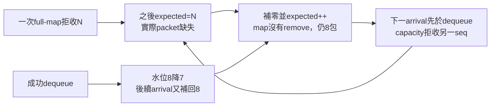

# Stage A.5：故障放大機制與診斷儲存評估

日期：2026-10-11（Asia/Taipei）。被審查基準：`46cdcae`。本次只新增test-only觀察／虛擬時鐘scenario、離線audit工具和文件。沒有改Jitter/Renderer策略、capacity/target、SRC ratio、wire format、production診斷sink或導入SQLite依賴；Stage B–D仍暫緩。

## 1. 主要結論

**9個封包是淨速率差，不是容量丟棄或deadline deficit的上界。** 已在實際Jitter/Renderer重現：一次capacity refusal建立future hole；該slot到期補零時expected前進，但map沒有移除一包，所以水位仍滿；下一個arrival又被capacity policy拒絕，建立另一個future hole。固定arrival-first相位下形成移動的缺口循環。持續正drift會进一步增加缺口密度。

不是「同一包被加上萬次」：本案unique arrivals、一次arrival最多drop1。不是capacity事件反覆倒退expected：本案playout epoch始終1、slot單調，沒有late、forward拒收、三空deadline reset或cursor rewind。`jitter_capacity_reject_farther`沿用BUFFER_RESYNC事件名稱，沒有真正resync。

**+50→0ppm仍不自癒**（原arrival-first排程，額外20虛擬分鐘觀察）；+50→-50ppm只剩首次drop與其後一次缺slot，之後穩定。相同0ppm、僅把同時ready事件改為tick-first，也停止循環：平均速率、phase、既有occupancy／hole狀態與task事件順序是不同條件。這是可重現的演算法／排程敏感放大机制，不是已確認的ESP32、Wi-Fi或WASAPI實機根因；不是證明所有0ppm相位都無法恢復。

## 2. Counter Semantics Table

所有更新位置依symbol查閱，來源：[Jitter與Playback](../crates/mic-audio/src/lib.rs)、[Diagnostics](../crates/mic-audio/src/diagnostics.rs)、[network actor/account_audio](../crates/mic-network/src/lib.rs)、[SequenceTracker](../crates/mic-audio/src/sequence.rs)、[Telemetry delta](../crates/mic-telemetry/src/lib.rs)。數字皆需附母體，不能直接相加作「網路丟包」。

| 名稱／實際欄位 | 所有更新路徑與單位 | 重複／初始化／重疊語意 |
|---|---|---|
| Stage A `capacity_drops` | test Result取 `Jitter.metrics.jitter_buffer_drops`，**其實是capacity + forward-rejected drops累計**。default push: distance>100加1；滿8包replace-farthest或reject-farther各加1。legacy容量clear加原map len；legacy forward clear未同樣增加此drop欄位。 | 不能一般化稱它全部capacity；本案audit證實forward_decisions=0，全部是capacity。只清音訊狀態的reset保留Metrics累計，不是窗口值。 |
| 真capacity decision / `buffer_overruns` | default map len>=8時加1，不論替換或拒收；不包括default forward rejection。legacy容量clear／forward jump各加1。 | 每次decision一次，不等於丟了幾包；可在startup prefill尚未出列時發生。本案1decision丟1incoming。 |
| `missing_slot` / `lost_packets` | operational `tick_inner` 找不到expected時加1；expected先+1，輸出160-sample零幀，包含mute。prefill不足直接return不加。 | **slot deadline deficit**，不是wire loss；同一slot在同epoch只有一次，但reanchor到以前slot後可再計不同epoch的deadline。source slot丟棄與稍後missing可是一個因果事件的不同stage。 |
| `late_packet` / `late_packet_drops` | default/legacy push: nonduplicate packet behind expected；startup退後<8可調anchor，不加late；否則加1並return。 | 是arrival被拒絕的次數，不是unique永久loss。未admitted packet不一定在seen，重傳可以再late／再reject；已seen duplicate在late判斷前return，不加late。 |
| `buffer_underrun`（Jitter） | missing slot且非muted，加1；muted仍有lost_packets與BUFFER_UNDERRUN event，但reason明示muted。 | prefill不增加；underrun不是另一次丟包，與lost_packets同一deadline可同步加。 |
| `buffer_underruns`（Engine/API合計） | `Engine.metrics`把Jitter值加Playback.underruns；callback stats.short且非muted時Playback.underruns加1。network audio_counters同樣合計後轉per-device delta。 | **混合jitter deadlines與starved callbacks兩種事件次數**，不能當samples或packet loss。callback inactive/prefill silence本身不是stats.short；開output但未stream不因此加starvation。 |
| `BUFFER_UNDERRUN` Diagnostics count | Jitter missing每次emit一次（包括muted），enabled時attempted counter先加，即使queue滿也計attempt/drop；worker buckets只計成功進queue的event。 | 累計count、`counts_60s`、recent128與fault archive行數是不同母體；counts_60s是current second加前59個秒桶，不是精確滑動60秒。 |
| `BUFFER_RESYNC` Diagnostics count | Jitter default forward rejection、capacity replace/reject；legacy容量clear/forward jump；three-empty reset；Engine scheduler rebuffer；Playback backlog clear，各emit。 | **沒有單一實際reset總計數**。多種decision都共用此event；capacity/forward-rejected不改cursor/epoch。一般START/STOP reset不為此fabricate event。disabled時event/counter停止，audio metrics照常。 |
| `jitter_capacity_reject_farther` | capacity branch保留近expected的8包，incoming不比farthest更近→拒收incoming；同時overruns+1、jitter_buffer_drops+1、BUFFER_RESYNC emit。 | 不清map、不reanchor、不增playout epoch、不回復已掉包內容。拒收包不加入seen，因此**重送相同包**可再次拒收；本案沒有重送，每個seq只arrival一次。 |
| `receiver_clock_resets` / historical BufferResync | actor deadline>20ms overdue時reset timer/Engine.rebuffer、counter+1，另telemetry event；historical underrun/deadline事件在10次邊界抽樣。 | 本虛擬harness沒有Tokio overduebranch；不能用historical抽樣事件數替代完整Audio Diagnostics。這些歷史事件不進本案reason計數。 |
| `sequence_gaps` | 獨立SequenceTracker經40ms grace finalize可見holes；metrics在Engine tick同步。 | arrival端序號缺口，與Jitter掉包不同。尾段沒有higher sequence不能枚舉loss；本harness直接Jitter.push，未執行Engine的SequenceTracker，不能宣稱此矩陣量到gap0。 |

短test `capacity_missing_counter_semantics_and_epoch_wrap`確認：同一未admitted seq重送兩次→兩次capacity decision、非duplicate；缺slot→lost與非muted underrun同加；late不增加capacity/forward drop；mute只停止audible underrun counter；wrap進序正確。這個重送test用來說明counter語意，**不是本案上萬次事件的原因**。

## 3. 實際重現方法與完整時間軸

擴充[Stage A test harness](../crates/mic-audio/src/clock_drift_tests.rs)，增加optional observer與piecewise production schedule；仍執行同一actual Jitter、Declicker、Renderer。16k device、160-frame callback、RX tick固定10ms；source160 samples/packet、+50ppm，無network fault。只有test透過私有Jitter狀態讀取expected、map sequences與counter snapshots；production不增加hook。

Trace時基是**virtual_ns**，不是Diagnostics實際Instant。實際emit reason在各operation後從既有event queue讀出，關聯到該virtual operation；不假裝是ESP/RX硬體timestamp。Playout epoch讀既有diagnostic atomic；packet tuple=`[sequence, 原header sample index]`；slot是實際dequeue decision前expected。generate、arrival、playout、callback都有before/after map/counter/epoch；played／concealed_zero_slot／discarded_packet等outcome來自實際counter delta。

Observer只留first drop前12秒rolling history、後12秒detail（因事件粒度保留略少於整12秒，仍涵蓋前後至少10秒）；上限history5000／timeline10000 steps。整段保存逐秒水位/counters、reason總計、最終狀態，不保存所有30分鐘逐callback rows。沒有將測試observer擺進CPAL或UDP production path。

重現指令（rx工作目錄）：

```powershell
$env:MIC_DRIFT_ARTIFACT_DIR = Join-Path (Get-Location) 'artifacts/drift-stage-a5'
cargo test -p mic-audio --locked --target-dir target/drift-validation amplification_and_rate_recovery -- --ignored --nocapture
python -X utf8 scripts/analyze-amplification.py artifacts/drift-stage-a5 --output artifacts/drift-stage-a5/audit.json
```

輸出 `baseline.json`等五個scenario完整trace、`*-levels.json`、`summary.json`、`audit.json`。JSON結果明示on_off_equal與checksum；原始detail保持在ignored artifacts，重要發現與數值在本文件版本保存。Stage A.5 audit不實作buffer模型，只驗證actual-code輸出、matching dropped seq→missing slot→next refusal與守恆。

### 首次Capacity Drop的狀態

* virtual t≈**1200.000000秒**（f64 ns值1199999999999.9998，arrival比timer1200秒略早）
* incoming seq=**120006**，header Source Sample Index=**19,200,960**
* expected=**119998**，其logical sample起點=19,199,680（按此test固定160 samples推導）
* map=`[119998,119999,120000,120001,120002,120003,120004,120005]`
* occupancy=8、contiguous=8、started=true、playout epoch=1
* incoming距expected8，farthest距7→`jitter_capacity_reject_farther`
* decision前delivered119998、missing0、drops0；後drops1、overrun1、received120007；map／expected／epoch均未變。

### 初始放大鏈（+50ppm原排序）

| virtual秒 | 實際行為 | decision前expected / map水位 | decision後 |
|---:|---|---|---|
| ≈1200.000000 | 拒收seq120006（sample19200960） | expected119998、8包完整 | 保留原8包，drops1；沒有真正resync |
| 1200.000000 | 播119998 | 119998、8 | map降至7、expected119999 |
| 下一些deadlines | 120007..120014等unique arrival補回map；依序播119999..120005 | 同一epoch，游標逐slot前進 | dropped120006仍不存在 |
| **1200.080000** | 缺seq120006，補零slot120006 | expected120006、**8包** | **仍8包**、expected120007、missing1 |
| **1200.089995500** | 新arrival120015被拒收 | expected120007、8包 | 建立下一個hole120015，drops2 |
| 1200.090000 | 播120007 | map8 | 降至7；下一arrival又補回8 |
| **1200.170000** | 補零slot120015 | map8 | 仍8，expected120016 |
| **1200.179991000** | 拒收seq120024 | map8 | 建立hole120024 |
| 1200.260000／1200.269986501 | 補零120024／拒收120033 | map8 | 同一機制繼續 |

raw detail還有已播與補零的每一個slot，以及所有incoming sample index，不只顯示抽樣error。初始序號鏈是120006→120015→120024→120033，間距9 slots，缺slot後下一個arrival拒收約相隔10ms；每代hole大約90ms後重演。



圖是已量測的arrival-first回授鏈，不代表每次queue full都會出現循環；沒有cursor回退或重新進入舊source window。

## 4. 為何9個淨差可有11,680次Drop

設R=distinct收到的packets，P=真packet成功出列，Z=補零slots，D=實際丟棄packets，Q=剩餘map packets。無duplicate/late/eviction-other/reset的本案例：

```text
R = P + D + Q
logical playout deadlines L = P + Z
因此 D - Z = R - L - Q
```

**補零算完成一個時間槽，但不消耗一個buffer packet。** 因此L可以保持100/s，而有效packet移除P變少；大量D與Z同步上升，在守恆式中互相抵銷。淨source超額限制的是D−Z加queue變化，不是D或Z個別的大小。

actual baseline最終：R=180010、P=168322、Z=11676、D=11680、Q=8、L=179998：

```text
180010 = 168322 + 11680 + 8
179998 = 168322 + 11676
11680 - 11676 = 180010 - 179998 - 8 = 4
```

0ppm對照：R180000、P179998、Q2、D/Z0。因此相較control的10個discrete arrivals差，等於queue增加6加D−Z=4。理想連續算式是`100 packet/s × 50e-6 × 1800s = 9 packets`；此f64 event schedule在1800秒half-open邊界把一個原本應恰在終點的generation算到略早，因此actual多10不是9。這是**1包的離散／floating endpoint差異**，已明示，不可能解釋上萬次事件。沒有為對齊理論去改Stage A時鐘或預期數值。

本案每個arrival最多一次drop、unique ingress／duplicate0／late0／forward rejection0；多個counter可描述同一decision與其後deadline，但D與Z均為真實不同stage行為，不是單純將一個底層事件重複相加後當drop總量。繼續+50ppm使更多capacity/hole鏈互相作用；最後60秒1637 missing/drop，遠高於單鏈0ppm約667／60秒。

## 5. Resync、窗口與恢復結果

| scenario | virtual時長 | 累計Missing / Drop | 最後60個完整逐秒點的Missing / Drop增量 | 恢復觀察 |
|---|---:|---:|---:|---|
| 0ppm control | 1800秒 | 0 / 0 | 0 / 0 | 穩定 |
| +50ppm持續 | 1800秒 | 11676 / 11680 | 1637 / 1637 | 未穩定 |
| 首次drop後 +50→0ppm | 2400秒 | 13333 / 13334 | 667 / 667 | 原arrival-first相位仍持續循環 |
| 首次drop後 +50→-50ppm | 2400秒 | 1 / 1 | 0 / 0 | 後續正常packet delivery恢復，無新循環 |
| +50→0ppm，故障後ties改tick-first | 2400秒 | 1 / 1 | 0 / 0 | 相同平均rate亦可恢復，顯示排序／phase敏感性 |

rate切換在首次capacity decision當下生效，保持至下一generation剩餘period比例，然後以continuous source sequence重新建立schedule base；**不**用`sequence×new_period`跳時間、不重置source index／session／Jitter／Renderer。第五組只變virtual equal-time事件優先序，且在首次drop前保持原排序；不是改production Tokio select，也不是提議以固定優先序作修正。

每組on/off PCM rolling checksum、levels與全部Result相同。checksum只比較同scenario的on/off；不同rate／排序的waveform本來不同，不要求跨scenario相等。

### 六個問題的證據回答

1. **第一drop是否造成大量missing？** 確认它創造第一hole；actual trace驗證同seq到deadline補零，再保持滿map並拒下一包。獨立零rate seeded counterexample也重現，不需持續增加速率差。
2. **是否Resync回到已播／已補零slot？** 本案沒有。只有initial anchor建立一次epoch transition（0→1）；之後始終epoch1、expected逐slot遞增、cursor_rewinds=0。所有Resync reason是capacity reject，不是真正reset。既有empty reanchor另外可rewind（Stage A既有test），不可把另一路径混入此因果。
3. **是否重複相同Sequence Window？** 沒有回到相同absolute sequences。反覆的是相對形狀／操作鏈（full→拒收future→missing仍full→再拒收），整個window跟cursor前進。wrap則須按modular ordering看，不用plain排序。
4. **一次arrival多次拒收？** 本scenario否，max_drop_one_arrival=1；同arrival同時overrun/drop/BUFFER_RESYNC可各計一次，不能合併成三包loss。只有另做重送才可能對相同seq多次decision。
5. **滿／空震盪？** baseline與0 recovery故障後occupancy最小7、最大8；不是8↔0，也不觸發three-empty reset。-50恢復時逐漸可降到2，map仍非空。
6. **回0必然恢復？** 否。固定arrival-first缺口回授能維持；回-50或tick-first對照可打破，不是所有輸入下不可逃逸的永久狀態。2400秒是觀察窗口，不能由此宣稱已跑無限時間。

本案顯示平均drift補償回0也未必足以清除既有hole/capacity循環；未來Stage B／C需分別驗證rate穩態與fault-state recovery，而不是只看水位有界。仍未確診使用者實機故障。

## 6. 不變條件：現有保證與Stage C待定

| 條件 | 狀態／證據 | 未來設計／驗收需要 |
|---|---|---|
| 同playout epoch slot單調前進 | 本case全runobserver逐slotassert modulo+1通過；normal tick先expected++ | 首次prefill anchor調整／reset必須分epoch；property test含wrap與所有policy |
| 已播／已補slot不得無故重新待播 | 本capacitycase不重播；empty reset後可在**新epoch**重新anchor到已補slots，既有行為 | 明訂有reason的rebase與discard/merge策略，不能把跨epoch當正常連續timeline |
| wrap不破壞順序 | existing ahead與bounded forward window；新增MAX→0測試通過 | half-range／source timestamp unwrap／restart來源依舊需分清 |
| occupancy有界 | actual全scenario≤8、ring≤1600通過 | 有界≠健康；不得用頻繁drop／clear達成水位平台驗收 |
| 缺包不永久等待 | operational cursor每tick前進，map空三miss可re-prefill | **進度保證不足以穩定播放**，本casecursor前進仍持續補零 |
| 真resync有明確epoch transition | Stage A記actual jitter reset/anchor及ring output epoch；capacity事件不切epoch | 統一reason-specific transaction／event taxonomy；不要讓BUFFER_RESYNC名字誤導 |
| healthy input恢复後不無限重复错误模式 | **尚未保证**：0 recovery与seeded零rate test失敗；没有OS/网络上界也不能要求无条件恢复 | 約定有限phase/jitter/arrival界，對既存holes提供bounded recovery；需Stage C設計，這次不修 |

### 保留的失敗回歸

```powershell
$env:MIC_DRIFT_ARTIFACT_DIR = Join-Path (Get-Location) 'artifacts/drift-stage-a5'
cargo test -p mic-audio --locked --target-dir target/drift-validation zero_rate_recovery_contract -- --ignored --nocapture
```

此test用actual Jitter建立full、started window，再每虛擬10ms先arrival一個unique packet、後tick（**零淨rate差**）。首drop允許一次缺slot，但期待90個warmup deadlines後不再missing。實際last90 deadlines missing=**10**，desired=**0**，明確assert失敗；輸出 `known-unmet-zero-recovery.json`（capacity drops20、expected181）。沒有修改期望或核心使它pass。標為explicitly ignored是為讓一般workspace檢查不把已知未實作Stage C contract混成新修正；本次確實手動執行並保存失敗，**不能報全部測試通過**。

## 7. JSONL與SQLite評估

### 7.1 選項與建議

**目前保留A；若跨場次查詢需求增加，優先評估B（可重建index），不建議直接C。** 本次根因證據是packet/cursor/occupancy語意與事件順序，換storage不會打破回授鏈。没有SQLite寫入benchmark；下表的效能／成本是架構評估，不是測得latency數字。

| 指標 | A JSONL + Manifest（現行） | B JSONL + SQLite Summary Index | C SQLite主要Telemetry Storage |
|---|---|---|---|
| 寫入延遲 | 背景sequential append／輪替；無transaction，全局一致性較弱 | JSONL照舊，index非即時batch importer；SQL失敗可重建 | batch/commit/checkpoint成本，需要P50/P99與stall實測 |
| 音訊隔離 | 現有fixed RT queues／worker | importer獨立thread/process，**禁止hot-path SQL** | 一樣需bounded queue→單writer；不能把connection塞callback/receive/tick |
| RAM上限 | pending64桶、detail queues固定；離線analysis另看讀檔模式 | bounded importer buffer、page cache、短查詢；DB不自動保證總RAM上限 | queue/cache/statement/reader必須限量，避免writer慢時RAM增長 |
| 併發 | 每instance owner files，跨檔一致性靠manifest | 一writer，多read；避免長read transaction阻checkpoint | WAL仍一writer，同步checkpoint可能拖慢某commit，需writer治理 |
| 長跑穩定 | per-run caps，old runs沒有global quota；高錯誤可能耗32MiB archive | 索引保留與raw保留分開；index停掉不妨礙raw recorder | central outage／busy／diskfull可令全部telemetry不可用，風險較大 |
| disk控制 | detail64MiB +summary32+fault32，manifest；每run有界而目錄累積 | raw原budget加DB/WAL quota；DELETE不等於縮檔 | page reuse／VACUUM或incremental vacuum、WAL/checkpoint上限，不能只用row TTL |
| crash recovery | 缺尾行、2秒summary tail／manifest不一致可能，沒有fsync commit保證 | index transaction可回復到commit；raw完整性仍原限制、offset replay可重建 | transaction一致性較強；powerloss durability取決synchronous/VFS/硬體；不是自動零遺失 |
| 跨場次查詢 | grep／scripts、需多檔join與去重 | 最有價值：sessions、窗口/epoch/event索引、artifact引用 | 最方便SQL查詢，但高頻packet rows容易膨脹 |
| migration | 無DB migration，JSON schema version／parser compatibility仍需管理 | user_version與importer/schema version；老JSON可reimport | 全量storage migration、回退雙寫／backup更昂貴 |
| Windows部署 | 無新增庫，現有Rust binary | 可先external工具；若bundled SQLite才納入build/size/license/version pin測試 | native build或DLL分發及更新／WAL sidecars/backup管理更強；無已測成本数字 |

WAL允許read與write併行但只有一writer；長reader可阻checkpoint、某些查詢仍可能BUSY，NORMAL模式可能丟掉powerloss前近期commit。因此SQL不能被稱為hard realtime或無界保證。[SQLite WAL官方文件](https://www.sqlite.org/wal.html)。交易恢復依赖filesystem/VFS假設，不能只搬main db檔卻忽略live WAL／journal。[Atomic Commit](https://www.sqlite.org/atomiccommit.html)、[Corruption caveats](https://www.sqlite.org/howtocorrupt.html)。

### 7.2 B的最小schema（提案，未導入）

以下四表可支援B，亦能成為C的子集；**沒有新增Rust DB依賴或production SQL**。session_pk代表一個run/clock/stream context，不只wire Session，因同Session可能START多個stream。

```sql
PRAGMA foreign_keys = ON;
PRAGMA user_version = 1;

CREATE TABLE diagnostic_sessions (
  session_pk INTEGER PRIMARY KEY,
  run_id TEXT NOT NULL,
  session_id TEXT,                     -- wire Session; idle may be NULL
  stream_id INTEGER NOT NULL,
  clock_id TEXT NOT NULL,
  clock_domain TEXT NOT NULL,          -- rx_monotonic_us / virtual_ns / tx_us
  source_clock_domain TEXT,            -- header sample-index domain
  start_mono_us INTEGER NOT NULL,
  end_mono_us INTEGER,
  build_commit TEXT NOT NULL,
  scenario TEXT,
  recorder_schema_version INTEGER NOT NULL,
  completeness TEXT NOT NULL,
  UNIQUE(run_id, clock_id, stream_id)
);

CREATE TABLE diagnostic_artifacts (
  artifact_pk INTEGER PRIMARY KEY,
  session_pk INTEGER NOT NULL REFERENCES diagnostic_sessions(session_pk),
  artifact_kind TEXT NOT NULL,          -- detail/summary/faults/wav/loopback
  path TEXT NOT NULL,
  segment_ordinal INTEGER NOT NULL,
  clock_id TEXT NOT NULL,
  first_mono_us INTEGER,
  last_mono_us INTEGER,
  playout_epoch INTEGER NOT NULL DEFAULT -1,
  output_epoch INTEGER NOT NULL DEFAULT -1,
  byte_size INTEGER,
  committed_import_offset INTEGER NOT NULL DEFAULT 0,
  sha256 TEXT,                         -- final immutable artifact, otherwise NULL
  available INTEGER NOT NULL,
  UNIQUE(session_pk, artifact_kind, segment_ordinal)
);

CREATE TABLE telemetry_seconds (
  session_pk INTEGER NOT NULL REFERENCES diagnostic_sessions(session_pk),
  window_start_us INTEGER NOT NULL,
  window_end_us INTEGER NOT NULL,
  playout_epoch INTEGER NOT NULL,
  output_epoch INTEGER NOT NULL,       -- -1 = not collected, not a real epoch
  artifact_pk INTEGER REFERENCES diagnostic_artifacts(artifact_pk),
  byte_offset INTEGER,
  invalid_reasons_json TEXT NOT NULL,
  admitted_population_json TEXT NOT NULL,
  statistics_json TEXT NOT NULL,
  PRIMARY KEY(session_pk, window_start_us, playout_epoch, output_epoch)
);

CREATE TABLE diagnostic_events (
  event_pk INTEGER PRIMARY KEY,
  session_pk INTEGER NOT NULL REFERENCES diagnostic_sessions(session_pk),
  mono_us INTEGER NOT NULL,
  playout_epoch INTEGER NOT NULL DEFAULT -1,
  output_epoch INTEGER NOT NULL DEFAULT -1,
  event_type TEXT NOT NULL,
  reason TEXT NOT NULL,
  packet_sequence INTEGER,
  expected_sequence INTEGER,
  source_sample_index INTEGER,
  artifact_pk INTEGER NOT NULL REFERENCES diagnostic_artifacts(artifact_pk),
  byte_offset INTEGER NOT NULL,
  payload_json TEXT NOT NULL,
  UNIQUE(artifact_pk, byte_offset)      -- keep genuine same-timestamp events
);
CREATE INDEX event_context_time ON diagnostic_events(session_pk, mono_us);
CREATE INDEX event_reason_time ON diagnostic_events(event_type, reason, mono_us);
CREATE INDEX artifact_context_time ON diagnostic_artifacts(session_pk, first_mono_us);
```

clock domain來自context FK，每筆必須能join；`*_us`是統一微秒單位，virtual clock原ns／細分順序另保留原payload與artifact offset，不能因整數µs取整而合併事件。RX ingress/header只存u32sample index，沒有跨clock同步就不能拿TX_us減RX_us。telemetry/artifact可跨epoch，-1明示不可收集／mixed，不代表epoch0；record原JSON保留完整缺失、window/population、counter累計/增量語意。u64counter若超SQLite有號INTEGER範圍要以JSON decimal或TEXT存，不可wrap。事件以canonical fault archive import，避免detail的event複本造成雙算；相同timestamp不作unique key，不能刪掉真重複事件。

`user_version`由app作transactional migration；**不手動改SQLite自己的schema_version**。rebuildable B可在版本不支援時丟index再重建；C須backup/rollback及migration故障測試。含null epoch的composite UNIQUE可能重複，因此提案用-1 sentinel與quality欄位明示。[官方PRAGMA參考](https://www.sqlite.org/pragma.html)。

### 7.3 writer、retention與驗收

* B先以獨立離線importer讀完結或sealed JSONL段；以artifact byte offset進度與DB batch transaction同步commit，partial tail不匯入、retry不重複。raw recording不能等待index；schema不要求JSON SQL extensions，payload作TEXT由importer驗證。
* 若未來live index：單writer、bounded queue、100–500ms或固定小batch commit；BUSY/diskfull丟index backlog／標unknown，保留可重建offset。所有blocking SQL/fsync/cache spill在worker，不在CPAL／UDP／playout；即使SQL出RT仍需CPU/disk A/B。
* Retention須明確total disk quota（db+wal+shm+raw+captures）、場次/TTL/row budget；raw evict更新artifact.available，不默默讓查詢把缺檔視為不存在事件。高頻packet/detail**繼續JSONL**，DB只1Hz summary與必要event索引；event洪水保留累計attempted/admitted/drop/byte-budget資訊，不能抽樣錯誤然後稱完整。
* maintenance分批delete與短read pagination；長reader timeout、WAL byte上限／checkpoint progress告警。journal_size_limit只限制reset/truncate後剩餘journal大小，不能替代即時總quota；刪row通常只釋放可重用pages，需要planned vacuum策略才縮檔，vacuum不放hotpath。[官方PRAGMA](https://www.sqlite.org/pragma.html)。
* Windows建置可比較static bundled與pinned DLL，需查runtime SQLite版本／compile options、受支持修正版及license；backup使用SQLite backup API或乾淨checkpoint/close snapshot，不能複製live main file當完整run。官方有Windows預編譯工具／DLL，但本次沒有安裝、連結或量測打包大小。[官方下載](https://www.sqlite.org/download.html)。
* B go/no-go：多場次query明顯省時、index可重建、schema fault不影響PCM、所有writer/queue/disk bounds可驗證；crash、powerloss、reader stall、WAL balloon、diskfull／readonly、DB migration/reimport、fault-copy dedup與真重複事件保留都需測。C還須量callback P99與失敗時退回JSONL成本；目前證據不足，不啟動。

## 8. 驗證、限制與下一階段

本次实际執行五組actual-code虛擬scenario（30／40分鐘），每組on/off、checksum／counter/levels一致。+50baseline精確重現11676/11680；0 control正常；0 recovery仍有循環；-50與tick-first對照穩定。所有scenariocursor單epoch模前進、沒有同epoch重播、每arrival最多drop1；Counter Semantics／wrap test通過。audit守恆與detail去重入列檢查通過。

一般workspace／clippy/fmt/diff檢查與已知失敗contract分開回報。上述known-unmet test确實失敗並保留；沒有把期待的自癒改成「允許667 error/min」來取得pass。本次不重新執行實機capture/loopback或聲學聽測；沒有production行為變更，所以既有API硬體測試不是此因果調查的證明。

實際結果：一般workspace **80 tests passed、4 ignored**（含兩個既有Stage A長測試、新investigation長測試與known-unmet contract）；本次另外手動執行investigation長測試passed，最後12秒detail版本耗130.88秒wall time，不是等待2400秒。known-unmet contract另跑明確failed（10≠0）；audit包含Stage A數值一致性、packet conservation、unique arrivals與±10秒以上覆蓋檢查passed。SQLite四表提案DDL僅用Python標準庫的**in-memory** database驗證語法/FK定義可建立，未產生DB檔案或Rust dependency，未做寫入效能／crash benchmark。

修改檔案：test-only `clock_amplification_tests.rs`、既有 `clock_drift_tests.rs`的optional observer/rate-profile；`lib.rs`只新增`#[cfg(test)] mod`註冊；`scripts/analyze-amplification.py`、本文件。不動diagnostic production storage。輸出artifact保留在ignored目錄；生成數據不是Git原始碼或實機驗收。

下一步先將這個**phase-sensitive full-map/hole循環**列為Stage C設計輸入：要求rate回nominal後、在有限arrival/timer相位與jitter界內有bounded恢复；對hole/full-map recovery或reanchor/time-scale選項評估對内容丟棄及latency的影響。Stage B也需從已存在hole狀態測補償，不只從空buffer啟動。**本次不啟動B–D，不建議把tick-first或整批clear直接當修復。**

實機判別仍需抓同類鏈：某capacity-dropped seq稍後missing、map仍full、下一unique arrival又drop，且epoch未變；另核對timer overdue、arrival batch/phase、原source/header、callback/ring及loopback。若實機沒有這條鏈，就不能套用本virtual結論。
